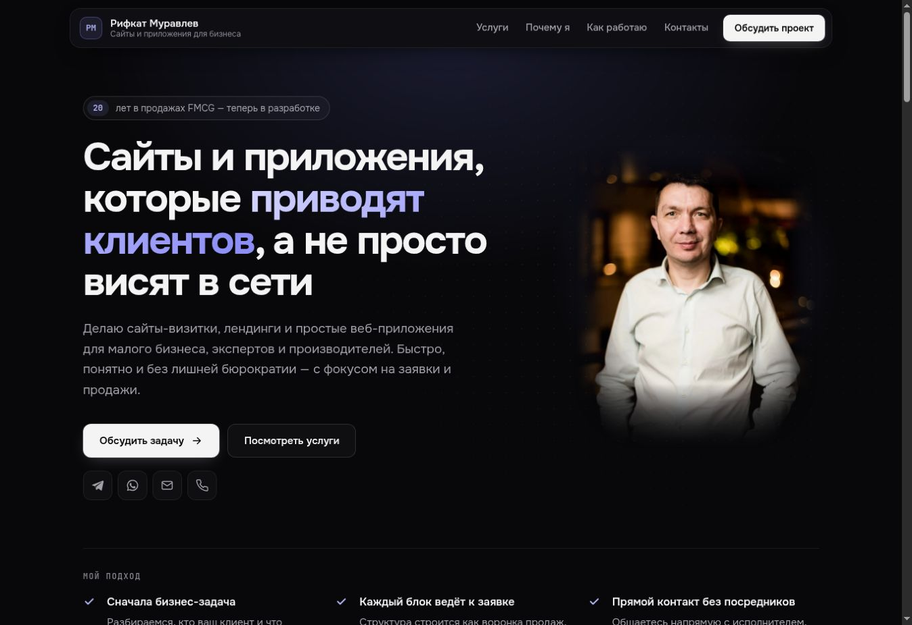
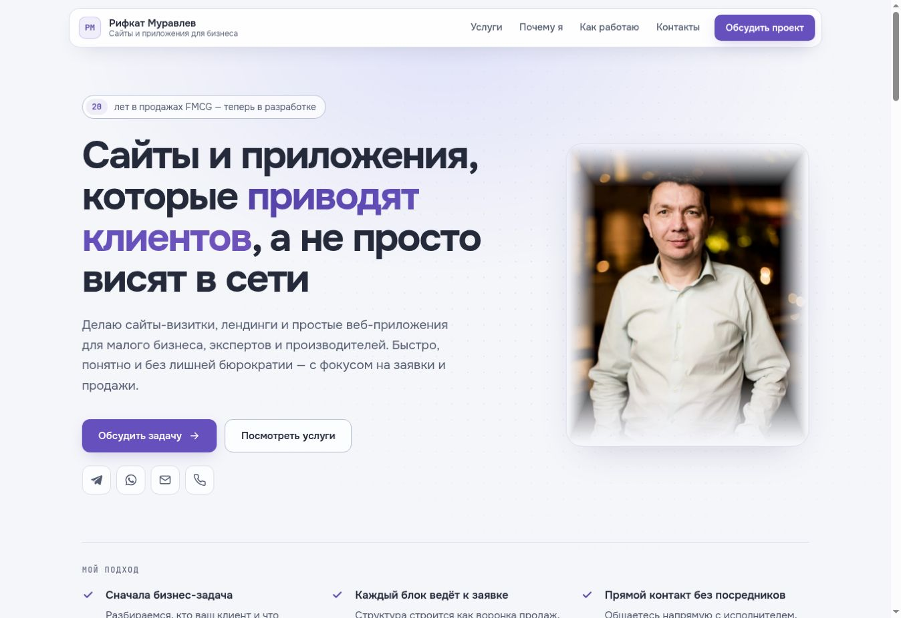
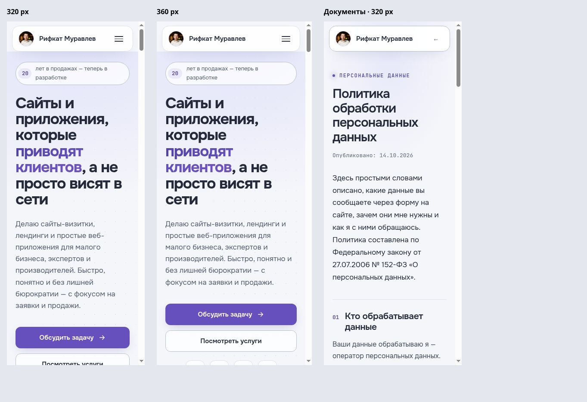
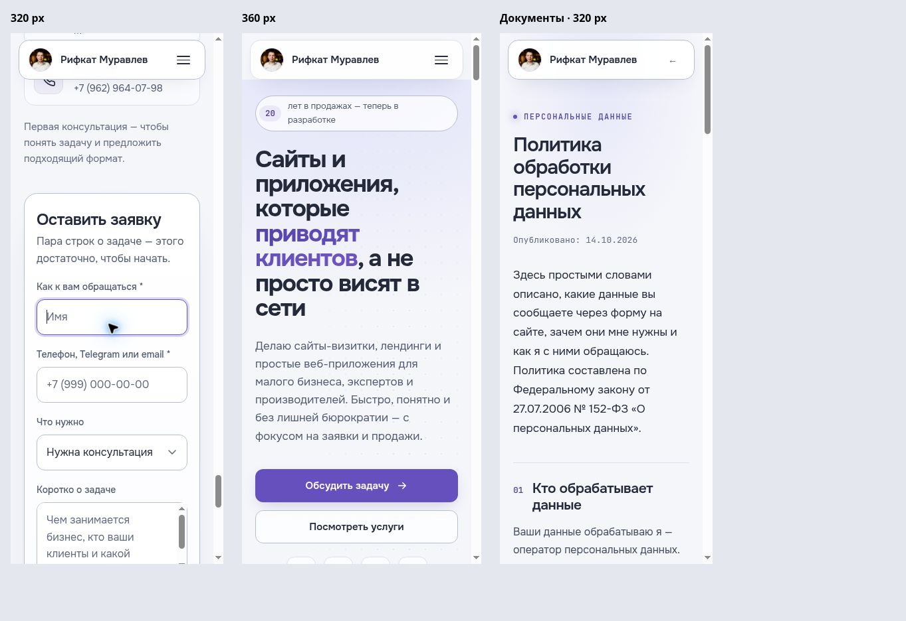

# Светлый вариант — 21 ноября 2026

Подготовлен в отдельной ветке `design/light-background`. Публикация на SpaceWeb не выполнялась. Работы по Яндексу приостановлены по просьбе владельца.

## Сохранённая версия

До изменений создана и проверена удалённая ветка `backup/dark-before-light-2026-11-21` на коммите `560a90ba38d1b3b2641f58343f6a3d789cdfb459`. Это актуальный GitHub `main` на момент начала работы, включая robots.txt и sitemap.xml.

Тёмная версия остаётся доступной по этой ветке и SHA. Для возврата к ней достаточно использовать содержимое сохранённого коммита; переписывать историю Git не требуется. `main` в рамках этой работы не изменяется.

## Изменения

- На главной, в политике и согласии применён светло-серый фон `#f5f6fa`, белые поверхности и тёмный текст.
- Сиреневый акцент затемнён для читаемости на светлом фоне. Кнопки, поля, меню, ссылки, выделение, ошибки и успешные состояния согласованы с новой палитрой.
- Тени стали мягче; CSS-оформление портрета адаптировано к светлому фону. Исходные файлы фотографий не изменены.
- Тексты, структура HTML, ссылки, JavaScript, локальные шрифты и остальные ресурсы сохранены. Изменены только CSS и метаданные theme-color трёх страниц.

## Проверки

- `git diff --check` — PASS.
- Сравнение с сохранённым коммитом после исключения блоков `<style>` и `meta[name=theme-color]` — полное совпадение трёх HTML-файлов.
- `node tests/contact-form.test.cjs` — 6/6 PASS.
- Локальный просмотр главной и карточек услуг на настольном экране — PASS.
- Мобильные фреймы 320×800 и 360×800: горизонтального переполнения нет. Фактическая ширина области документа с учётом полосы прокрутки — 305 и 345 CSS px соответственно.
- Меню при узкой ширине открывается и закрывается после выбора «Контакты».
- Пустая форма показывает ошибку; «Нужна консультация» отображается целиком в узком фрейме.
- Политика и согласие открываются со светлой палитрой.

Это локальная проверка в браузере, не тест на физическом телефоне. Письма не отправлялись. В доступном журнале обнаружены сообщения служебного расширения `chrome-extension://…`; ошибок с адресом сайта при проверке не обнаружено. Полный аудит доступности не проводился.

## Снимки

### До изменений

### Светлая главная

### Узкие экраны и политика

### Форма на узком экране

