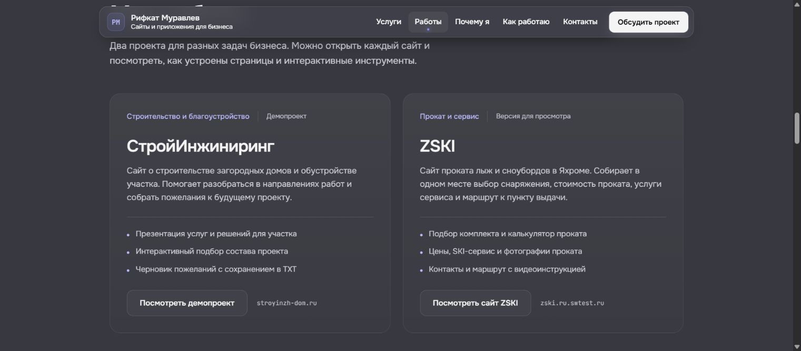

# Первые работы в портфолио — 24 ноября 2026

На https://murrif.ru/#works опубликован раздел «Мои работы» с двумя проектами и добавлен пункт меню «Работы». Основа — GitHub main `b2ec2cd25d2ad0f6f5a4006647e963fb2c4f02ae`.

## Содержание и область изменения

- «СтройИнжиниринг»: https://stroyinzh-dom.ru/. Строительство и благоустройство, интерактивный состав проекта, сохранение пожеланий в TXT. На самом сайте указана демоверсия; карточка прямо обозначена как демопроект.
- ZSKI: http://zski.ru.swtest.ru/. Прокат лыж и сноубордов в Яхроме, подбор комплекта, калькулятор, сервис и маршрут. Сохранён адрес, предоставленный владельцем, и указано «Версия для просмотра».

Использованы две карточки в существующем стиле, с перестроением в один столбец на узких экранах. Для дополнительного пункта меню адаптированы отступы и логотип в промежутке 861–1050 px. Ссылки открываются в новой вкладке с `noopener noreferrer` и поясняющими доступными названиями.

На хостинге изменён только `index.html`: добавлены стили карточек, пункт меню и раздел. Существующие скрипты, услуги, контакты, фотографии и фон `#383840` сохранены. Нет новых зависимостей, изображений, аналитики или серверной отправки. Репозитории и хостинг двух представленных проектов не изменялись.

## Предварительная проверка

В пределах выполненной проверки поломок не обнаружено; исправлений существующего кода не потребовалось.

- Опубликованные главные страницы трёх сайтов доступны по HTTP(S); исходная главная murrif.ru совпадала с базовой версией.
- Проверены синтаксис загруженных JavaScript, JSON в соответствующих script-блоках, уникальность ID и существование локальных якорей.
- Проверенные ресурсы и ссылки на HTML-страницы вернули 200: «СтройИнжиниринг» — 22, ZSKI — 48, murrif.ru — 5 непосредственно найденных в главной ресурсов. Это число ссылок в проверке, не полный перечень файлов проектов.
- `node --test tests/*.test.cjs`: **27/27 PASS** до и после изменения (форма, меню, контраст).

Доказательства: [проверка кода и ресурсов](portfolio-code-check-2026-11-24.json), [результат тестов](portfolio-tests-2026-11-24.tap).

## Проверка публикации

- Все **14 публичных файлов** murrif.ru вернули 200; байты и SHA-256 совпали с рабочими файлами. SHA-256 новой главной: `91ff09e295edcfd7e7d6aaa18c52856a861a189877e134d4c2864da4dd7aa7e0`.
- Главная не содержит `noindex`; настройки приватной копии для просмотра на основной сайт не перенесены.
- HTTP главного имени и проверенного пути www возвращает 301 на HTTPS без www, сохраняя путь и параметры.
- При ширине содержимого 320 CSS px и 1521 CSS px нет горизонтального переполнения. На приватной копии также проверена ширина 900 CSS px: пункты меню не пересекаются с логотипом.
- На опубликованном сайте пункт «Работы» переводит к разделу и закрывает мобильное меню. Escape закрывает меню и возвращает фокус на кнопку открытия.
- Обе ссылки карточек реально открыты с опубликованной страницы; адреса и заголовки новых вкладок соответствуют проектам.
- Пустая форма показывает «Пожалуйста, укажите имя и способ связи», фокусирует имя; query string остаётся пустым. Реальные письма не отправлялись.
- Доступный журнал проверяемой вкладки: предупреждений и ошибок не получено.

Доказательства: [ответы сервера и хеши](portfolio-http-2026-11-24.json), [измерения браузера](portfolio-browser-2026-11-24.json).

## Резервная версия и откат

До публикации сохранена базовая версия:

- GitHub: ветка [`backup/before-portfolio-2026-11-24`](https://github.com/daydrneg1974-star/murrif-site/tree/backup/before-portfolio-2026-11-24) указывает на `b2ec2cd25d2ad0f6f5a4006647e963fb2c4f02ae`.
- SpaceWeb: полная копия `public_html` в `/home/p/pridomahru/murrif_ru/backup-before-portfolio-2026-11-24`, вне публичной папки. Создание копии и итоговое имя подтверждены в файловом менеджере; побайтовая сверка всей резервной папки и репетиция восстановления не выполнялись.

Для отката раздела вернуть `index.html` из резервной версии в `/home/p/pridomahru/murrif_ru/public_html`, проверить ответ и хеш; в GitHub оформить обратное изменение новым коммитом без переписывания истории. Другие файлы возвращать не требуется.

## Границы проверки

Это проверка добавления портфолио и предварительная проверка опубликованного кода, а не полный аудит исходных репозиториев двух проектов. Не проверялись все бизнес-сценарии этих сайтов, юридические документы, физические телефоны, все браузеры и доставка писем. Ширины выше относятся к окну Chrome. Полного аудита безопасности не проводилось. Даты отчёта указаны по часовому поясу пользователя, технические отметки JSON — UTC.
