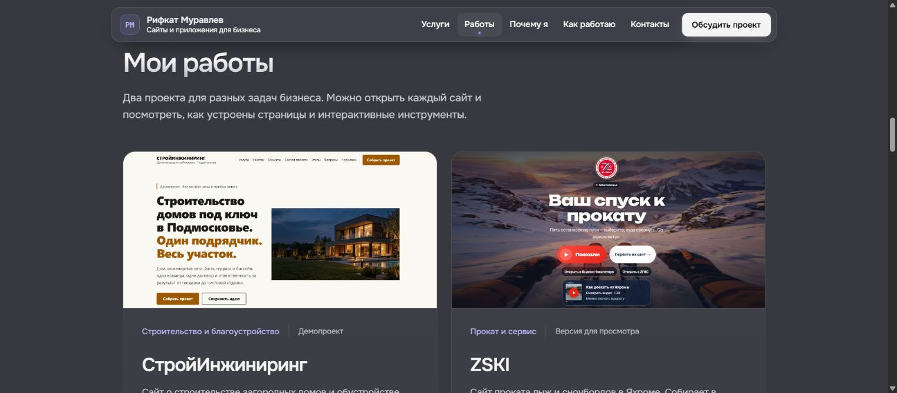

# Стартовые экраны проектов и финальная проверка — 24 ноября 2026

На https://murrif.ru/#works опубликованы реальные снимки первых экранов «СтройИнжиниринга» и ZSKI. Нажатие на изображение открывает соответствующий сайт в новой вкладке. Основа изменения — main `a6f8ba1653280bf7d81df2c988052cf8e900ebb4`.

## Изображения и загрузка

| Файл | Источник | Размер | Объём |
| --- | --- | --- | --- |
| `portfolio-stroy.jpg` | https://stroyinzh-dom.ru/ | 1521 × 722 | 102 998 байт |
| `portfolio-zski.jpg` | http://zski.ru.swtest.ru/ | 1536 × 674 | 104 881 байт |

Это снимки отображённых страниц Chrome, без генерации изображений. Первый экран ZSKI — вступительный экран «Ваш спуск к прокату». Использован вид, который открывается посетителю по предоставленной ссылке.

Изображения хранятся на murrif.ru. Вместе они занимают **207 879 байт, около 203 КиБ**. У обоих указаны `loading="lazy"`, `decoding="async"`, исходные ширина и высота; CSS заранее резервирует одинаковую область с отношением сторон 2:1. Изображение заполняет область с небольшим обрезанием боковых краёв. У ссылок есть доступные названия и `noopener noreferrer`.

Не добавлены iframe, видео, внешние скрипты, библиотеки или постоянно работающие анимации. Исходные сайты внутри карточек не запускаются. Время фактической загрузки lazy-изображений выбирает браузер, в том числе заранее до появления в окне.

## Найденная и исправленная ошибка

В квизе существовала задержка 250 мс между ответом и следующим вопросом. Если в это время нажать «Назад», старый таймер мог отменить возврат и снова перевести вперёд. Ошибка воспроизведена отдельным тестом до исправления: ожидался вопрос с индексом 0, фактически показывался вопрос 1. Остальные четыре новых сценария проходили.

Теперь идентификатор таймера сохраняется, а кнопка «Назад» отменяет ожидающий переход и снимает флаг занятости. Проверено, что после возврата квиз остаётся работоспособным и доходит до другого результата.

Изменение JavaScript ограничено этим обработчиком. Обработчик контактной формы сохранён. Фон, фотографии владельца, контакты, услуги, документы, DNS и HTTPS-конфигурация не менялись. Соседние проекты на хостинге не изменялись.

## Проверки

- `node --test tests/*.test.cjs`: **32/32 PASS** — прежние 27 проверок и пять сценариев квиза. Проверены все три результата, передача в форму, перезапуск, повторный ответ и быстрый возврат.
- Синтаксис обоих скриптов проверен Node; повторяющихся ID и несуществующих локальных якорей нет. `git diff --check` проходит.
- До основной публикации проверена приватная копия на ширинах содержимого 1521 и 320 CSS px.
- После публикации все **16 публичных файлов** вернули 200 и побайтово совпали с исходниками. Новая главная: SHA-256 `ffd60d07fda4ddcd61ac3e9842e0d5c3130cf6fbcbe919023bfaee158a1dcfb1`.
- На основном сайте обе картинки загрузились; горизонтального переполнения при 320 и 1521 CSS px нет. Размеры областей изображений одинаковы в обеих карточках.
- Мобильное меню открывается, переходит к работам и закрывается; Escape возвращает фокус на кнопку меню.
- С опубликованных снимков реально открыты оба проекта; адреса и заголовки вкладок соответствуют ссылкам.
- В браузере пройден квиз с возвратом, получено «Веб-приложение», услуга перенесена в форму; перезапуск возвращает первый вопрос.
- Пустая форма показывает ошибку и фокусирует имя, query string остаётся пустым. Настоящие письма не отправлялись.
- В доступных журналах проверявшихся вкладок не было предупреждений и ошибок.

Доказательства: [тесты](portfolio-screens-tests-2026-11-24.tap), [ответы сервера](portfolio-screens-http-2026-11-24.json), [наблюдения браузера](portfolio-screens-browser-2026-11-24.json).

## Резервная версия и откат

- GitHub: [`backup/before-portfolio-screens-2026-11-24`](https://github.com/daydrneg1974-star/murrif-site/tree/backup/before-portfolio-screens-2026-11-24), исходный коммит `a6f8ba1653280bf7d81df2c988052cf8e900ebb4`.
- SpaceWeb: `/home/p/pridomahru/murrif_ru/backup-before-portfolio-screens-2026-11-24` — копия `public_html` до загрузки изображений и замены главной. Создание и итоговое имя подтверждены в панели. Полная побайтовая сверка резервной папки и репетиция отката не выполнялись.

Для отката достаточно вернуть прежний `index.html` в `/home/p/pridomahru/murrif_ru/public_html` и проверить ответ сервера. Два JPEG после этого не используются; их можно оставить. Обратное изменение GitHub оформлять новым коммитом, без переписывания истории.

## Ограничения

Проверены конкретные сценарии и размеры окна Chrome, не физический телефон и не все браузеры. Инструментального измерения FPS, INP, ограниченной сети и производительности слабых устройств не выполнялось. Отсутствие зависаний в проверенных сценариях не является гарантией для любого устройства и соединения. Реальные письма, юридическое содержание и полный аудит безопасности не проверялись.

Правило локальной папки пользователя учтено: доступ к диску его компьютера в текущем режиме отсутствует, об этом сообщено до начала работы. Подготовлен архив актуальных файлов; создание и распаковка папки на компьютере пользователя не заявляются выполненными. Основные исходники и доказательства сохранены в GitHub. Дата отчёта указана по поясу пользователя; технические отметки JSON — UTC.
